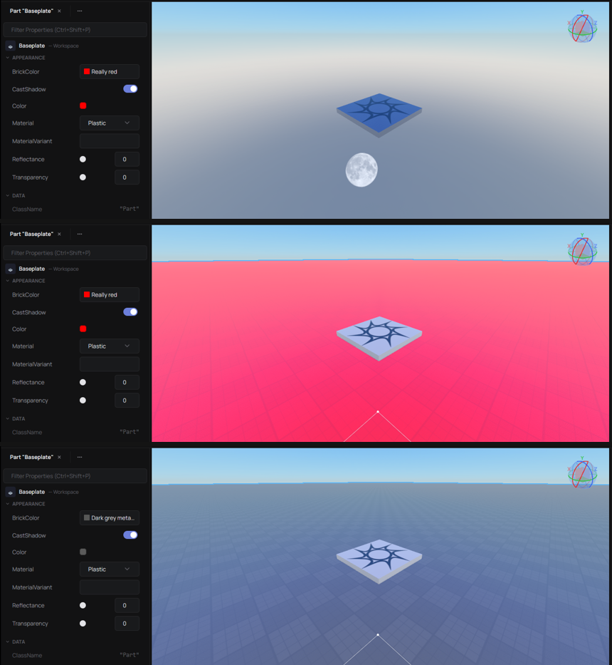
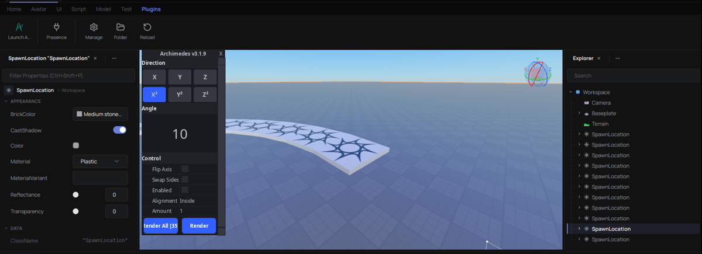
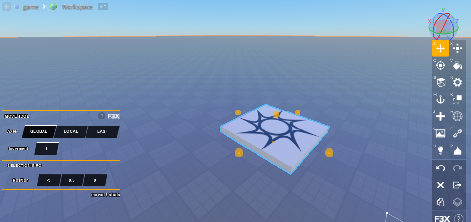

# Plugins

rbx-native runs two kinds of plugin inside the editor: real Roblox Studio
plugins (Luau, written against Studio's `plugin` API) and its own native
plugins (Luau or WebAssembly, described by a `plugin.toml`).

Examples live in `examples/plugins/`:

- `roblox/SelectionInspector.lua`: toolbar, dock widget, `Handles`.
- `native/tint`: a Luau native plugin that colours the selection.
- `native/count-parts`: a WASM (`.wat`) native plugin that counts parts.

## Where plugins are loaded from

- Roblox plugins: rbx-native's own plugins folder (`<config dir>/plugins`,
  e.g. `~/.config/rbx-native/plugins`, or `RBX_STUDIO_PLUGINS_DIR`) and,
  unless switched off in Manage Plugins, Roblox Studio's own `Plugins`
  folder (`%LOCALAPPDATA%\Roblox\Plugins`, `~/Documents/Roblox/Plugins`, or
  the Vinegar prefix's on Linux). A `.lua`/`.luau` file runs as one `Script` named
  after the file. A `.rbxm`/`.rbxmx` runs every enabled `Script` in it
  (`LocalScript`s and `ModuleScript`s are not started); `require` resolves
  the `ModuleScript`s inside the same file.
- Native plugins: one folder per plugin inside rbx-native's plugins folder,
  each with a `plugin.toml`.

Each plugin gets its own Luau VM. The plugin manager lists every plugin with
its origin and the last error that stopped one of its scripts from loading.
It opens with the cursor in its search field, which filters the list as you
type by name, creator (known for plugins installed from Popular plugins) or
kind; every word typed has to match.

## Popular plugins

Manage Plugins has a second tab, Popular plugins (also Plugins › Popular on
the ribbon). It lists the free Creator Store plugins verified to run here
(the table under [Community plugins](#community-plugins)), each with its
store icon, creator, live vote count and a "Runs in rbx-native" badge.
Install downloads the plugin from Roblox and starts it right away, without
restarting the others; Uninstall stops it and deletes its file; Update shows
when the store's copy changed since you installed it. The search field
finds any other free plugin on the store (no badge: those weren't tested).

- rbx-native ships no plugin code. The catalog in
  `shell/plugins/catalog/list.rs` is ids, names and our own one-line
  descriptions; the plugin itself comes from Roblox at install time.
- The store data (details, search, icons) uses Roblox's anonymous public
  routes. The download needs your Open Cloud key (Home › Manage key), as
  Roblox refuses anonymous plugin downloads.
- Installed plugins land in the plugins folder as `<name>.rbxm`;
  `<config dir>/plugin-catalog.json` remembers which file is which store id
  and the store's update time it was downloaded at.
- Paid plugins are never offered and are refused at install.

Why a curated list plus search, not search alone: the store's own ranking
puts plugins that have never been tried here next to ones that work, and a
badge only means something if someone checked. The verified list comes
from the headless sweep below; search covers the long tail.

## What works

| Area | Supported |
| --- | --- |
| `plugin` | `CreateToolbar`, `CreateButton` (`Click`, `SetActive`, `Enabled`), `CreatePluginAction`, `CreatePluginMenu` (`ShowAsync`), `CreateDockWidgetPluginGui`, `DockWidgetPluginGuiInfo.new`, `GetSetting`/`SetSetting`, `Activate`/`Deactivate`, `GetMouse`, `OpenScript`, `Unloading` |
| `Selection` | `Get`, `Set`, `Add`, `Remove`, `SelectionChanged` |
| `ChangeHistoryService` | `SetWaypoint`, `TryBeginRecording`/`FinishRecording`, `Undo`, `Redo`, change signals |
| `HttpService` | `JSONEncode`/`JSONDecode`, `GenerateGUID`, `UrlEncode`, `RequestAsync`, `GetAsync`, `PostAsync` |
| `RunService` | `IsStudio`, `IsEdit`, `Heartbeat`, `RenderStepped`, `Stepped` |
| `CollectionService` | tags over the `Tags` property |
| `StudioService`, `settings()` | a few constants; `settings().Studio.Theme` is Studio's own Dark palette (every `StudioStyleGuideColor` and modifier, read from Studio) and `settings().Studio.ThemeChanged` |
| `UserInputService` | `InputBegan`/`InputChanged`/`InputEnded` (from widget and overlay input), `GetMouseLocation`, `IsMouseButtonPressed`, the `*Enabled` flags |
| `TextService`, `TweenService` | `GetTextSize` (estimated metrics); `Create` → `Play` sets the goals and fires `Completed` |
| `Workspace` | `Raycast`, `GetPartBoundsInBox`, `FindPartsInRegion3`; `JoinToOutsiders`/`UnjoinFromOutsiders` do nothing (no joints without physics) |
| `Camera` | `ViewportSize` (the editor's 3D view), `ScreenPointToRay`/`ViewportPointToRay` |
| Widgets | `GuiObject` trees, `UIListLayout`, `TextButton`, `TextBox`, `ScrollingFrame`, clicks, text input, scrolling, `InputBegan`/`InputEnded` with an `InputObject`, real `AbsoluteSize`/`AbsolutePosition`/`AbsoluteContentSize` fed back from the render |
| Overlays | a `ScreenGui` parented to `CoreGui` is drawn over the 3D view, with no top-bar inset; buttons, text boxes and `Active` objects take the pointer, anything else lets it through to the view |
| 3D adornments | `Handles`, `ArcHandles` (coloured per axis as in Studio), `*HandleAdornment`, `SelectionBox` in `CoreGui` |
| Debugger | `GetDebuggerManager` (see below) |

A plugin's scripts sit under a `Plugin` instance, so
`script:FindFirstAncestorWhichIsA("Plugin")` reaches the same API as the
`plugin` global. Settings keep Roblox values in the form Studio's own
settings files use (`{"name": "Top", "serializedType": "NormalId"}`,
`{"x", "y", "z", "serializedType": "Vector3"}`), and `SelectionChanged`
also fires for the plugin that called `Selection:Set`, as in Studio.

Every plugin edit can be undone. A user input a plugin handles (a button,
a widget click, a handle drag, a prompt answer) is one undo step, and so is
a press through its release in the 3D view. Edits a plugin makes on its own
from `task.delay`, `Heartbeat`, a selection or change handler, gather
into one step that ends at the plugin's next
`ChangeHistoryService:SetWaypoint`, the user's next action, or Ctrl+Z.





[Archimedes](https://create.roblox.com/store/asset/144938633) (Scriptos's
arc builder, Roact + StudioComponents) is the reference plugin: it runs
from a plain `.rbxm`: its window over the 3D view, the direction buttons,
**Render**, **Render All** and undo. The `run_plugin` example
(`cargo run -p rbx_lua --example run_plugin -- place.rbxl plugin.rbxm`)
runs a plugin headless; `RUN_PLUGIN_SELECT=<name>` selects a part and
`RUN_PLUGIN_CLICK=<text>` clicks a widget element by its text.

The first HTTP request from a Roblox plugin to a host asks the user for
permission; the answer is remembered in the plugin's settings.

## Community plugins

The most-voted free plugins on the Creator Store were run through the
headless harness (start, every toolbar button, `RUN_PLUGIN_USER_ID=1`, on a
release build), and the big ones by hand in the editor. The list is the
store's top plugins by up votes, paid ones left out, as of 2026-11-02:
47 plugins, 43 start and answer their buttons with no error. "Runs"
means the plugin loads and its toolbar works without an error, not that
every feature was exercised. Every one that runs is in the Popular plugins
catalog.



| Plugin | Up votes | Headless | Notes |
| --- | ---: | --- | --- |
| [Load Character Lite](https://create.roblox.com/store/asset/752585459) | 57000 | runs |  |
| [Lemonade AI](https://create.roblox.com/store/asset/85716018250741) | 17600 | runs |  |
| [Building Tools by F3X (Plugin)](https://create.roblox.com/store/asset/144950355) | 9600 | runs | live: installed from the catalog, select, move with handles |
| [Archimedes (v3.1.9)](https://create.roblox.com/store/asset/144938633) | 6720 | runs | live: installed from the catalog, its preview piece follows the selection |
| [Roblox Animation Editor](https://create.roblox.com/store/asset/144373835) | 6300 | no toolbar | retired by Roblox, inert; not in the catalog |
| [Resurface - Convert surfaces to studs and more](https://create.roblox.com/store/asset/5070921519) | 5820 | runs | live: installed from the catalog, toolbar opens |
| [ThreeDText 2](https://create.roblox.com/store/asset/2273628561) | 4800 | runs |  |
| [Part to Terrain](https://create.roblox.com/store/asset/261634767) | 4700 | runs | live: widget title localized |
| [Rebirth](https://create.roblox.com/store/asset/124244262358116) | 3840 | runs |  |
| [Stravant - GapFill & Extrude](https://create.roblox.com/store/asset/165687726) | 3840 | runs | live: panel opens |
| [AutoScale Lite](https://create.roblox.com/store/asset/1496745047) | 3680 | runs |  |
| [RigEdit Lite](https://create.roblox.com/store/asset/1274343708) | 3600 | runs |  |
| [Realism Mod](https://create.roblox.com/store/asset/400812710) | 3600 | runs |  |
| [Rig Editor](https://create.roblox.com/store/asset/2908380847) | 3440 | runs |  |
| [Asset Creator](https://create.roblox.com/store/asset/1602528167) | 2790 | runs |  |
| [Lighting Shading Plugin (Free)](https://create.roblox.com/store/asset/13964761992) | 2760 | runs | fixed: dock widget creation yields like Studio's |
| [Rain Plugin](https://create.roblox.com/store/asset/2166774609) | 2700 | runs |  |
| [Stravant - ResizeAlign](https://create.roblox.com/store/asset/165534573) | 1960 | runs |  |
| [RBXMonkey - Blender Animations](https://create.roblox.com/store/asset/16708835782) | 1860 | runs |  |
| [Brushtool 2.1](https://create.roblox.com/store/asset/2268520847) | 1820 | runs |  |
| [Avatar Importer](https://create.roblox.com/store/asset/1921957669) | 1820 | runs |  |
| [Maor's Gui Animation Plugin](https://create.roblox.com/store/asset/14972318524) | 1680 | runs |  |
| [Blender rig exporter/animation importer](https://create.roblox.com/store/asset/716953901) | 1660 | runs |  |
| [Legacy Animation Editor](https://create.roblox.com/store/asset/1882309978) | 1580 | runs |  |
| [Moon Animator Export Cutscene](https://create.roblox.com/store/asset/10546846471) | 1500 | runs |  |
| [Selection To Camera](https://create.roblox.com/store/asset/15142310521) | 950 | runs |  |
| [Accessory Inserter [UPDATED 2026]](https://create.roblox.com/store/asset/7055415547) | 940 | runs |  |
| [Ro-Defender™ Plugin v8.7](https://create.roblox.com/store/asset/142273772) | 940 | no toolbar | no toolbar or UI (minified loader); not in the catalog |
| [Load Roblox Characters 4](https://create.roblox.com/store/asset/8867876284) | 920 | runs |  |
| [Infinite Terrain](https://create.roblox.com/store/asset/7229545707) | 920 | runs |  |
| [Surface Converter](https://create.roblox.com/store/asset/5828862351) | 900 | runs |  |
| [Studio Build Suite](https://create.roblox.com/store/asset/260276858) | 900 | runs |  |
| [Light Editor](https://create.roblox.com/store/asset/1223999426) | 890 | runs |  |
| [Smooth Cam](https://create.roblox.com/store/asset/883602387) | 890 | runs | fixed: gamepad queries on UserInputService |
| [Paint on click](https://create.roblox.com/store/asset/3704545736) | 880 | runs |  |
| [Brick Cutter 🔪](https://create.roblox.com/store/asset/143152131) | 880 | runs |  |
| [[V2 Read Befor Updating] Add Easy Texture](https://create.roblox.com/store/asset/10366079803) | 860 | runs | fixed: `PluginManager():CreatePlugin()`, `GetAvailableThemes`, `ResetPropertyToDefault` |
| [Roundify](https://create.roblox.com/store/asset/2233768483) | 860 | runs |  |
| [Camera Light](https://create.roblox.com/store/asset/6274600541) | 846 | runs |  |
| [Model Resize Plugin 2.1 [ DRAG TO RESIZE! ]](https://create.roblox.com/store/asset/143613186) | 830 | runs |  |
| [UltraWorks Shop Creator [Pro tools]](https://create.roblox.com/store/asset/184275443) | 828 | runs | the 2026-10-16 failure no longer reproduces |
| [Weather Systems - FIXED?](https://create.roblox.com/store/asset/319094400) | 810 | error | calls `LoadLibrary("RbxGui")`, which Roblox removed; fails in Studio too |
| [Day/Night Cycle](https://create.roblox.com/store/asset/10824128781) | 790 | runs |  |
| [VFX Studio](https://create.roblox.com/store/asset/135581141962270) | 760 | runs | fixed: `debug.profilebegin`, wireframe adornment calls (not drawn); slow to start on a debug build |
| [Stravant - Model Reflect](https://create.roblox.com/store/asset/217792838) | 752 | runs | fixed: `GetSelectedRibbonTool` |
| [Scene Tools](https://create.roblox.com/store/asset/16976887711) | 728 | runs | fixed: plugin handles fit in `ObjectValue.Value` |
| [Stravant - Redupe (REpeated DUPElicate)](https://create.roblox.com/store/asset/73064993918325) | 693 | error | needs the `Content` datatype (`Content.none`), not in the host yet |

What made the difference, beyond the API itself: Roblox's identity rules
(one value per instance and per enum item), each script's own environment
(`getfenv(0)`, `_G`, `shared`, `require` by path, `wait` inside any
coroutine), the deprecated lowercase spellings, services made on demand,
`plugin:Activate` handing the plugin the 3D view's mouse, and images in
plugin GUIs drawn once they arrive.

## rbx-native additions

Available to every plugin, Roblox or native:

- `plugin:PromptColor3(initial?)`: yields; returns a `Color3`, or `nil` if
  cancelled.
- `plugin:PromptBrickColor(initial?)`: yields; returns a `BrickColor`, or
  `nil` if cancelled.
- `plugin:CreateFloatingWidget(id, {Size = Vector2, Position = Vector2?,
  LightDismiss = bool?})`: a widget that is not dockable and is drawn above
  the editor. With no `Position` it opens at the cursor; with `LightDismiss`
  a click outside closes it.
- `plugin:GetDebuggerManager()`: breakpoints, watches and stepping through
  the editor's debugger.

Native plugins also get `rbxnative.command(id, text, fn)`, which adds a
button to the Plugins tab, and `rbxnative.notify(text)`, which shows a toast.

## Native plugins: `plugin.toml`

```toml
name = "Tint"
version = "0.1.0"
description = "Colours the selected parts with a colour you pick."
entry = "init.luau"
permissions = ["selection", "dom.write"]
```

`entry` is relative to the manifest: an `init.luau`, or a `.wasm`/`.wat`
module. Unknown permissions are rejected when the manifest is read.

| Permission | Allows |
| --- | --- |
| `dom.read` | reading the place |
| `dom.write` | editing the place |
| `selection` | reading and changing the selection |
| `http:<host>` | HTTP to that host; `http:*` for any |
| `debugger` | breakpoints, watches, stepping |

## WASM ABI

A module exports `memory`, `rbxn_alloc(len: i32) -> i32` (a buffer the host
may write `len` bytes into), and optionally `rbxn_start()` (run once after
loading) and `rbxn_command(ptr: i32, len: i32)` (a registered command was
clicked; the bytes are its id, UTF-8).

It may import `rbxn.call(ptr: i32, len: i32) -> i64`. The bytes are a JSON
request `{"method": "...", "params": {...}}`. The host answers
`{"ok": value}` or `{"error": "message"}`, written into a buffer from
`rbxn_alloc`, and returns `(ptr << 32) | len`.

| Method | Permission |
| --- | --- |
| `log {text}`, `warn {text}`, `notify {text}` | none |
| `command.register {id, text, tooltip?}` | none |
| `selection.get`, `selection.set {refs}` | `selection` |
| `instance.roots`, `instance.get {ref}`, `instance.find {path}`, `instance.property {ref, name}` | `dom.read` |
| `instance.set_property {ref, name, value}`, `instance.new {class, parent?, name?}`, `instance.set_parent {ref, parent}`, `instance.destroy {ref}` | `dom.write` |

Refs are JSON numbers. `instance.get` returns `{ref, name, class, parent,
children}`; `instance.find` takes a path like `"Workspace.Model.Part"`.
Property values are bool, number, string, `{"x","y","z"}` (Vector3),
`{"x","y"}` (Vector2), `{"r","g","b"}` (Color3, 0..1),
`{"position":[3],"rotation":[9]}` (CFrame), `{"enum": n}` or `{"ref": n}`;
other types read as `{"unsupported": "<type>"}` and cannot be written.

Modules run under `wasmtime` with a fuel budget per call and a memory cap, so
a plugin that walks a very large place in one call can run out of fuel.

## What cannot work

- Roblox's built-in plugins (Toolbox, Terrain Editor, …): they ship inside
  the Studio install and are written against internal Studio services and
  security levels that no plugin file is granted.
- Pixel-faithful plugin UI: widgets are drawn by rbx-native's own renderer
  and theme, so layout and styling can differ from Studio.
- CSG: `plugin:Union`, `Separate` and `Negate` raise an error naming the
  missing support.
- Features that need Roblox's servers or client: `GetStudioUserId` returns 0,
  `MarketplaceService` raises an error, and `PluginMouse` button and move
  signals never fire (`Hit` and `Target` follow the 3D view's hover).
- Luau rbx-native plugins without `dom.write` cannot change the place, but
  the check covers property, attribute and tag writes, reparenting,
  `Destroy`, `ClearAllChildren`, `PivotTo` and `Instance.new(class,
  parent)`; WebAssembly is the stricter sandbox.
