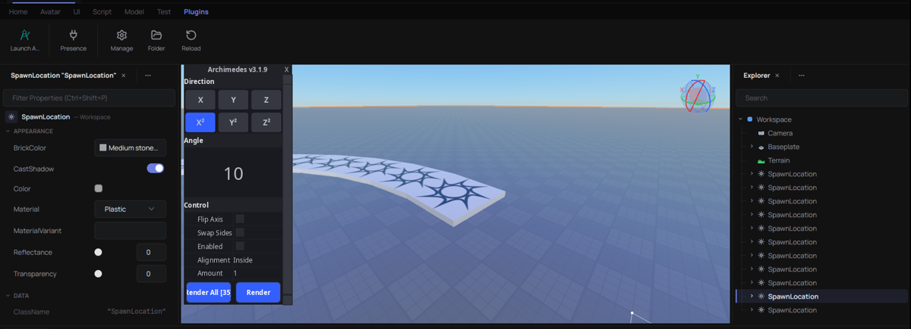

# Plugins

rbx-native runs two kinds of plugin inside the editor: real Roblox Studio
plugins (Luau, written against Studio's `plugin` API) and its own native
plugins (Luau or WebAssembly, described by a `plugin.toml`).

Examples live in `examples/plugins/`:

- `roblox/SelectionInspector.lua` — toolbar, dock widget, `Handles`.
- `native/tint` — a Luau native plugin that colours the selection.
- `native/count-parts` — a WASM (`.wat`) native plugin that counts parts.

## Where plugins are loaded from

- Roblox plugins: rbx-native's own plugins folder (`<config dir>/plugins`,
  e.g. `~/.config/rbx-native/plugins`, or `RBX_STUDIO_PLUGINS_DIR`) and,
  unless switched off in Manage Plugins, Roblox Studio's own `Plugins`
  folder (`%LOCALAPPDATA%\Roblox\Plugins`, `~/Documents/Roblox/Plugins`, or
  the Vinegar prefix's on Linux). A `.lua`/`.luau` file runs as one `Script` named
  after the file. A `.rbxm`/`.rbxmx` runs every enabled `Script` in it
  (`LocalScript`s and `ModuleScript`s are not started); `require` resolves
  the `ModuleScript`s inside the same file.
- Native plugins: one folder per plugin inside rbx-native's plugins folder,
  each with a `plugin.toml`.

Each plugin gets its own Luau VM. The plugin manager lists every plugin with
its origin and the last error that stopped one of its scripts from loading.

## What works

| Area | Supported |
| --- | --- |
| `plugin` | `CreateToolbar`, `CreateButton` (`Click`, `SetActive`, `Enabled`), `CreatePluginAction`, `CreatePluginMenu` (`ShowAsync`), `CreateDockWidgetPluginGui`, `DockWidgetPluginGuiInfo.new`, `GetSetting`/`SetSetting`, `Activate`/`Deactivate`, `GetMouse`, `OpenScript`, `Unloading` |
| `Selection` | `Get`, `Set`, `Add`, `Remove`, `SelectionChanged` |
| `ChangeHistoryService` | `SetWaypoint`, `TryBeginRecording`/`FinishRecording`, `Undo`, `Redo`, change signals |
| `HttpService` | `JSONEncode`/`JSONDecode`, `GenerateGUID`, `UrlEncode`, `RequestAsync`, `GetAsync`, `PostAsync` |
| `RunService` | `IsStudio`, `IsEdit`, `Heartbeat`, `RenderStepped`, `Stepped` |
| `CollectionService` | tags over the `Tags` property |
| `StudioService`, `settings()` | a few constants; `settings().Studio.Theme` is Studio's own Dark palette (every `StudioStyleGuideColor` and modifier, read from Studio) and `settings().Studio.ThemeChanged` |
| `UserInputService` | `InputBegan`/`InputChanged`/`InputEnded` (from widget and overlay input), `GetMouseLocation`, `IsMouseButtonPressed`, the `*Enabled` flags |
| `TextService`, `TweenService` | `GetTextSize` (estimated metrics); `Create` → `Play` sets the goals and fires `Completed` |
| `Workspace` | `Raycast`, `GetPartBoundsInBox`, `FindPartsInRegion3`; `JoinToOutsiders`/`UnjoinFromOutsiders` do nothing (no joints without physics) |
| `Camera` | `ViewportSize` (the editor's 3D view), `ScreenPointToRay`/`ViewportPointToRay` |
| Widgets | `GuiObject` trees, `UIListLayout`, `TextButton`, `TextBox`, `ScrollingFrame`, clicks, text input, scrolling, `InputBegan`/`InputEnded` with an `InputObject`, real `AbsoluteSize`/`AbsolutePosition`/`AbsoluteContentSize` fed back from the render |
| Overlays | a `ScreenGui` parented to `CoreGui` is drawn over the 3D view, with no top-bar inset; buttons, text boxes and `Active` objects take the pointer, anything else lets it through to the view |
| 3D adornments | `Handles`, `ArcHandles` (coloured per axis as in Studio), `*HandleAdornment`, `SelectionBox` in `CoreGui` |
| Debugger | `GetDebuggerManager` (see below) |

A plugin's scripts sit under a `Plugin` instance, so
`script:FindFirstAncestorWhichIsA("Plugin")` reaches the same API as the
`plugin` global. Settings keep Roblox values in the form Studio's own
settings files use (`{"name": "Top", "serializedType": "NormalId"}`,
`{"x", "y", "z", "serializedType": "Vector3"}`), and `SelectionChanged`
also fires for the plugin that called `Selection:Set`, as in Studio.



[Archimedes](https://create.roblox.com/store/asset/144938633) (Scriptos's
arc builder, Roact + StudioComponents) is the reference plugin: it runs
from a plain `.rbxm` — its window over the 3D view, the direction buttons,
**Render**, **Render All** and undo. The `run_plugin` example
(`cargo run -p rbx_lua --example run_plugin -- place.rbxl plugin.rbxm`)
runs a plugin headless; `RUN_PLUGIN_SELECT=<name>` selects a part and
`RUN_PLUGIN_CLICK=<text>` clicks a widget element by its text.

The first HTTP request from a Roblox plugin to a host asks the user for
permission; the answer is remembered in the plugin's settings.

## rbx-native additions

Available to every plugin, Roblox or native:

- `plugin:PromptColor3(initial?)` — yields; returns a `Color3`, or `nil` if
  cancelled.
- `plugin:PromptBrickColor(initial?)` — yields; returns a `BrickColor`, or
  `nil` if cancelled.
- `plugin:CreateFloatingWidget(id, {Size = Vector2, Position = Vector2?,
  LightDismiss = bool?})` — a widget that is not dockable and is drawn above
  the editor. With no `Position` it opens at the cursor; with `LightDismiss`
  a click outside closes it.
- `plugin:GetDebuggerManager()` — breakpoints, watches and stepping through
  the editor's debugger.

Native plugins also get `rbxnative.command(id, text, fn)`, which adds a
button to the Plugins tab, and `rbxnative.notify(text)`, which shows a toast.

## Native plugins: `plugin.toml`

```toml
name = "Tint"
version = "0.1.0"
description = "Colours the selected parts with a colour you pick."
entry = "init.luau"
permissions = ["selection", "dom.write"]
```

`entry` is relative to the manifest: an `init.luau`, or a `.wasm`/`.wat`
module. Unknown permissions are rejected when the manifest is read.

| Permission | Allows |
| --- | --- |
| `dom.read` | reading the place |
| `dom.write` | editing the place |
| `selection` | reading and changing the selection |
| `http:<host>` | HTTP to that host; `http:*` for any |
| `debugger` | breakpoints, watches, stepping |

## WASM ABI

A module exports `memory`, `rbxn_alloc(len: i32) -> i32` (a buffer the host
may write `len` bytes into), and optionally `rbxn_start()` (run once after
loading) and `rbxn_command(ptr: i32, len: i32)` (a registered command was
clicked; the bytes are its id, UTF-8).

It may import `rbxn.call(ptr: i32, len: i32) -> i64`. The bytes are a JSON
request `{"method": "...", "params": {...}}`. The host answers
`{"ok": value}` or `{"error": "message"}`, written into a buffer from
`rbxn_alloc`, and returns `(ptr << 32) | len`.

| Method | Permission |
| --- | --- |
| `log {text}`, `warn {text}`, `notify {text}` | none |
| `command.register {id, text, tooltip?}` | none |
| `selection.get`, `selection.set {refs}` | `selection` |
| `instance.roots`, `instance.get {ref}`, `instance.find {path}`, `instance.property {ref, name}` | `dom.read` |
| `instance.set_property {ref, name, value}`, `instance.new {class, parent?, name?}`, `instance.set_parent {ref, parent}`, `instance.destroy {ref}` | `dom.write` |

Refs are JSON numbers. `instance.get` returns `{ref, name, class, parent,
children}`; `instance.find` takes a path like `"Workspace.Model.Part"`.
Property values are bool, number, string, `{"x","y","z"}` (Vector3),
`{"x","y"}` (Vector2), `{"r","g","b"}` (Color3, 0..1),
`{"position":[3],"rotation":[9]}` (CFrame), `{"enum": n}` or `{"ref": n}`;
other types read as `{"unsupported": "<type>"}` and cannot be written.

Modules run under `wasmtime` with a fuel budget per call and a memory cap, so
a plugin that walks a very large place in one call can run out of fuel.

## What cannot work

- Roblox's built-in plugins (Toolbox, Terrain Editor, …): they ship inside
  the Studio install and are written against internal Studio services and
  security levels that no plugin file is granted.
- Pixel-faithful plugin UI: widgets are drawn by rbx-native's own renderer
  and theme, so layout and styling can differ from Studio.
- CSG: `plugin:Union`, `Separate` and `Negate` raise an error naming the
  missing support.
- Features that need Roblox's servers or client: `GetStudioUserId` returns 0,
  `MarketplaceService` raises an error, and `PluginMouse` button and move
  signals never fire (`Hit` and `Target` follow the 3D view's hover).
- Luau rbx-native plugins without `dom.write` cannot change the place, but
  the check covers property, attribute and tag writes, reparenting,
  `Destroy`, `ClearAllChildren`, `PivotTo` and `Instance.new(class,
  parent)`; WebAssembly is the stricter sandbox.
