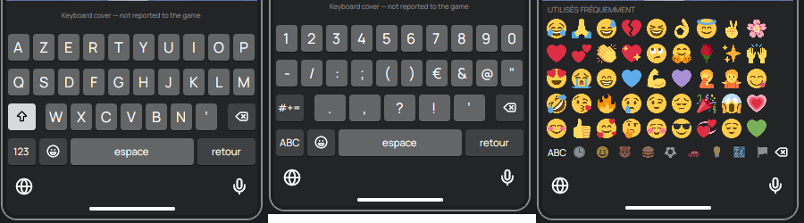
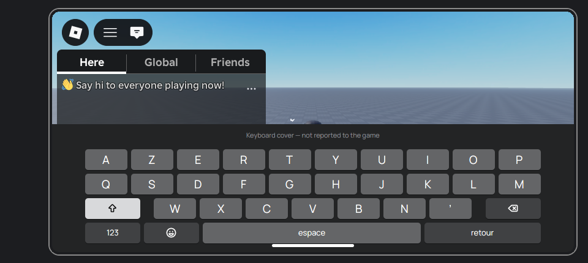
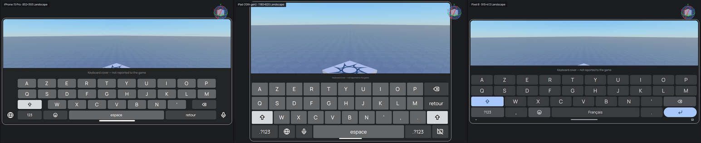
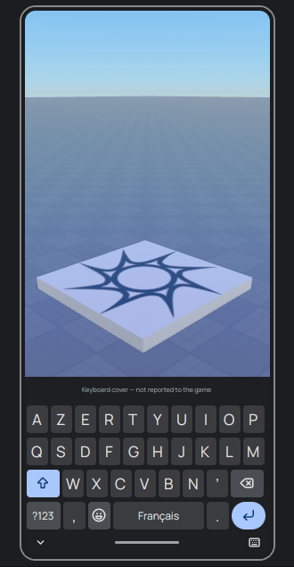
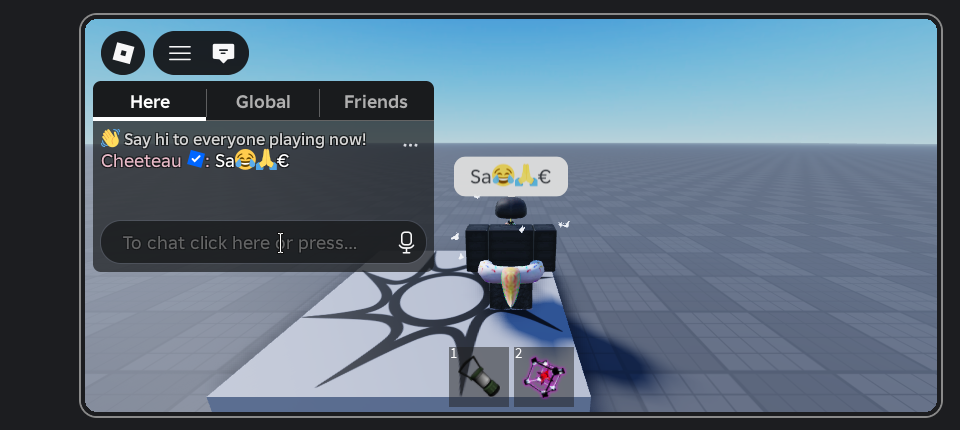

# Device Simulator: the open items

Labels: **Verified** (read from a primary source or measured here),
**Reported** (second-hand), **Unknown** (not found, or untested).
The Device Simulator itself (catalog, Edit letterbox, Play sizing, Sober
input modes) is in `crates/rbx_studio/src/device_sim.rs`,
`shell/device_sim.rs` and `workspace_view/device.rs`. This note covers what
was left open. Each item below has a verdict and the reasons for it.

Studio's own semantics come from creator-docs `studio/device-simulator.md`,
`studio/testing-modes.md` and the `StudioDeviceSimulatorService`, `Camera`
and `UserInputService` class pages (**Verified**, via `gh api`). Sober's come
from vinegarhq.org's Configuration, Tips and Tricks and FAQ pages
(**Verified**).

## 1. Live test of the Play half — built: the client reports itself

**Verdict:** done — run live on 2026-10-17 (Linux, Sober 1.8.0 embedded in
the editor on a nested Xephyr display, results under "Live run" below).
Every claim of the Play half holds; each Play also leaves a record in
Output, so a later run can be read back the same way.

`probe/client.luau` sends `{type = "device", ...}` (`Uplink::Device`) once at
start and again whenever a value changes. It checks every 0.25 s, and also
reacts at once when a TextBox gains or loses focus. The report carries:

- `Camera.ViewportSize`;
- `TouchEnabled`, `KeyboardEnabled` and `GamepadEnabled`;
- `GuiService:IsTenFootInterface()`;
- `PreferredInput`, read with a `pcall` because older clients lack it;
- `OnScreenKeyboardVisible`;
- whether a TextBox has focus.

While a device is simulated, the badge appends what the client reports, for
example `client 852×393 · touch · ten-foot off`. If the reported
`ViewportSize` is not the device's screen, the badge turns the warning colour
and names the expected size. The first report of each Play also goes to
Output as an Info line, for example
`Device check: ViewportSize 852×393, TouchEnabled true, …; simulated screen 852×393 (matches).`

Steps for a live test (Linux, Sober, X11):

1. Pick **Test → Device → iPhone 15 Pro**, landscape. Make the 3D view
   larger than 852×393 physical pixels.
2. Press **Play**. Wait for the client to appear inside the device bezel.
3. Read the Output line. Expected: `ViewportSize 852×393`, `TouchEnabled
   true` (Sober `touch_mode: "on"`) and `IsTenFootInterface false`.
   `ViewportSize` should equal the client window. Sober reports no safe-area
   insets, so the whole window is the viewport. **Verified** (live run).
4. **Rotate to Portrait**. The client window resizes live. The badge should
   read `client 393×852` with no warning.
5. Stop. Pick **Xbox Series X**. Play again; Sober reads its input mode at
   launch only. Expected: `IsTenFootInterface true`
   (`use_console_experience`). **Verified** (live run): `ten_foot` true,
   `TouchEnabled` false.
6. Focus a TextBox in the game. The badge's report flips `text_focus`, and
   the keyboard cover appears (item 5). `OnScreenKeyboardVisible` is
   expected to stay `false`, because Sober has no Android IME. **Verified**
   (live run).

### Live run (2026-10-17)

Read from the client's own `Uplink::Device` reports (`RBX_PLAY_TRACE=1`) and
the badge, with the sandbox place published by Play:

| Device, action | Client reported |
| --- | --- |
| iPhone 15 Pro, landscape | `ViewportSize` 852×393, `TouchEnabled` true, `KeyboardEnabled` true, `IsTenFootInterface` false, `PreferredInput` KeyboardAndMouse |
| Rotate to Portrait (view tall enough) | 393×852, live, no restart |
| Rotate to Portrait (view too short) | the client takes the whole panel, 1027×554; the badge says it does not fit |
| Pixel 8 picked mid-test | 915×412, live (same input class, no restart) |
| iPad Pro 12.9″ (larger than the view) | 1027×954 with the badge's warning `expected 1366×1024`, drawn above the client |
| Xbox Series X (new Play) | `IsTenFootInterface` true, `TouchEnabled` false |
| Xbox + Controller Emulator open | `GamepadEnabled` true, `PreferredInput` Gamepad |
| Pixel 8, a TextBox tapped | `text_focus` true, the keyboard cover appears; `OnScreenKeyboardVisible` false |
| iPhone 15 Pro, the chat bar tapped | the cover appears; tapping the scene drops it. `TextBoxFocused` does not fire for the CoreGui chat bar, so the probe also polls `TextChatService.ChatInputBarConfiguration.IsFocused` |
| Pixel 8, Android back button | Roblox's in-game menu opens; pressed again, it closes |
| iPhone 15 Pro, chat focused, "Sa😂🙏€" tapped on the cover, then return | the message arrives as typed, emoji and € included |
| iPhone 15 Pro, a click on the client | `GetLastInputType` MouseButton1: a click reaches the game as a mouse click, not a touch, though `TouchEnabled` is true |
| Controller Emulator open at Play, A held (Xbox, then Generic Gamepad) | the pad sends `BTN_SOUTH` on its `/dev/input` node and `GamepadEnabled` is true, but `GetLastInputType` stays Touch and the character does not jump, Sober focused or not, with `SDL_JOYSTICK_ALLOW_BACKGROUND_EVENTS=1` or without: Sober sees the pad but passes none of its input on |

Two notes from the run:

- With touch on, `PreferredInput` stays `KeyboardAndMouse` (the desktop's
  keyboard is present), so experiences that key their controls off
  `PreferredInput` show the desktop hotbar labels, not the thumbstick, until
  a touch arrives. `TouchEnabled` itself is true, as on a phone.
- The Network Simulator shaped the same client: `Players.LocalPlayer:
  GetNetworkPing()` read 502–506 ms with **Bad Connection (3G)** against
  101 ms with Off on the same server, i.e. +405 ms against the preset's mean
  added round trip of 410 ms (185 ms in + 225 ms out).

### Known caveats of Play through Sober

Measured in the live run above; each is a limit of Sober or of driving it
from outside, not of the probe.

- **Clicks are mouse clicks, not touches.** A click on the client reaches
  the game as `MouseButton1`; `GetLastInputType` never turns to Touch from a
  click, and there is no multi-touch (no pinch, no two-finger camera).
  `TouchEnabled` is still true. A virtual uinput touchscreen does not get
  round it either (tried live 2026-10-18 on a GNOME X11 desktop: Xorg takes
  the device as a direct-touch pointer, touches land at the right root
  coordinates, and Sober's window holds the XInput2 touch selection, yet a
  touch tap on Roblox's open menu leaves it open and a probe LocalScript
  sees neither `InputBegan` nor `TouchStarted`, where a mouse click on the
  same button closes the menu and reads `MouseButton1`). Sober drops X11
  touch input. A uinput device cannot be tested in the nested Xephyr
  either, since Xephyr takes its input from the host's core events.
- **A second Play in one editor session crashed GNOME Shell on X11**
  (mutter 46.2, `clutter_actor_add_child: assertion 'child->priv->parent ==
  NULL' failed`, then a trap) the moment the second Sober window was
  reparented into the editor; the first embed was fine. Not seen under
  Xephyr, which has no window manager.
- **Roblox's own thumbstick and jump button never appear**, since no touch
  ever arrives and `PreferredInput` stays `KeyboardAndMouse` (the
  PlayerModule shows its TouchGui only on `PreferredInput == Touch`).
  **Built: stand-in controls in the probe** (`probe/touch.luau`). On a
  client with `TouchEnabled` and no touch preference, the probe draws the
  PlayerModule's dynamic thumbstick and jump button with its sizes,
  positions and `TouchControlsSheetV2.png` images (taken from the
  PlayerModule source in the Roblox Client Tracker, May 2026), driven by
  the mouse: press in the stick region and drag to walk, click the jump
  button to jump. They keep Roblox's names (`TouchGui` >
  `TouchControlFrame` > `JumpButton`, `DynamicThumbstickFrame`) so a game
  script that moves or hides them finds them, follow
  `GuiService.TouchControlsEnabled`, `ModalEnabled`, `DevTouchMovementMode`
  (none for Scriptable and ClickToMove) and the humanoid's jump settings,
  leave presses on the game's own buttons alone, and stand down if a real
  touch ever makes `PreferredInput` Touch. **Verified** (live, Xephyr):
  the stick walks the character with Roblox's knob and trail, the button
  jumps it, and the layout follows rotation
  (`play-touch-controls-landscape.png`, `play-touch-controls-portrait.png`).
  Still not simulated: game code that listens for touches itself
  (`TouchStarted`, `TouchTap`, `InputBegan` with `Touch`, pinch and swipe)
  and UI chosen by `PreferredInput`, such as the hotbar's desktop number
  labels.
- **The Controller Emulator's pad does nothing in game.** Sober sees it
  (`GamepadEnabled` true) but passes none of its input on (row above).
- **The keyboard cover is ours, not the device's.** The game is not told:
  `OnScreenKeyboardVisible` stays false and `OnScreenKeyboardSize` 0, so UI
  that moves out of the keyboard's way does not. Its keys type through XTest
  (Linux only); the first use of a character missing from the X keymap
  (€, emoji) waits 0.3 s while Sober picks up the remapped key.
- **Android back is Escape.** It opens Roblox's menu, as on a phone, but a
  game sees it as `KeyCode.Escape`, not a distinct back key.

Screenshots: `device-simulator/play-iphone15pro-portrait.png`,
`play-pixel8-keyboard.png`, `play-iphone15pro-chat-keyboard.png`,
`play-pixel8-back.png`,
`play-ipadpro-doesnt-fit.png`.

## 2. Input modes on Windows — not possible from outside the client

**Verdict:** there is no switch. Nothing was built.

- `RobloxPlayerBeta` has no launch argument, setting or URI parameter that
  selects the touch or console UI (**Unknown**: none found). The
  `roblox-player:` parameters seen in the wild are launch plumbing only
  (**Reported**).
- Since 2025-09-29 the client honours only FFlags on Roblox's allowlist
  (**Verified**: devforum "Allowlist for local client configuration via
  Fast Flags"). The list holds geometry, rendering and one reduced-motion
  flag. None of them concerns touch, console or platform.
- `IsTenFootInterface` is "hardcoded to return true whenever the client runs
  on a console" (**Verified**: `GuiService.yaml`).
- Touch: since 2025-10-14, a device with a real touch surface reports
  `TouchEnabled = true` (**Verified**: devforum "Introducing PreferredInput
  and improved touch capabilities").
  - Windows can inject synthetic touch from a desktop app, with no admin
    rights stated: `CreateSyntheticPointerDevice` /
    `InjectSyntheticPointerInput` on Windows 10 1809+, and
    `InjectTouchInput` on Windows 8+ (**Verified**: Microsoft Learn).
  - Whether Roblox treats an injected pointer device as a touchscreen is
    **Unknown**. If the client decides from hardware enumeration, a
    synthetic device probably does not count.
  - Testing it would take a Windows machine. The test: inject a touch, then
    read `TouchEnabled` in the device report above.
- So on Windows, Play runs in the machine's own input mode. The Edit preview
  is unaffected.

## 3. Pixel density — built as display scaling in Edit

**Verdict:** density reaches no script. Roblox exposes no DPI member: the
`GuiService`, `UserInputService` and `GuiBase2d` pages have none
(**Verified**). Sober's `enable_hidpi` only "scales the game window to your
screen's pixel density" and reports nothing (**Verified**: Configuration
page). In Studio too, pixel density "drives physical-size scaling" and
nothing else (**Verified**). Its only observable effect is how big the
screen looks, so that is what was built.

- The catalog has each phone's and tablet's PPI and its pixels per point
  (or per dp) from the spec sheets. Monitors, TVs and the headset have none.
- **Device → Display scaling** offers three modes, persisted as
  `device_scaling`:
  - **Fit to window**, the default.
  - **Actual resolution**: one device point to one editor logical pixel,
    which is the size Play shows the client at.
  - **Physical size**: the device's inches on the monitor. The monitor is
    assumed to be 96 dpi × the window's scale factor, which is what Studio's
    auto-detect reads from the OS. There is no calibration slider. A screen
    with no density falls back to Fit.
- All three cap the Edit letterbox (`frame::Viewport::letterboxed`'s
  `max_scale`). A screen that does not fit still shrinks.
- Play stays 1:1, because a foreign window can be sized but not scaled
  (item 6).

## 4. A headset in Play — not possible on Linux; Windows untested

**Verdict:** Edit preview only, as before.

- Sober: "For VR, the Quest build does not ship with x86 code … We have no
  intention of changing this." (**Verified**: Sober FAQ.)
- Windows: Roblox's PC VR runs on OpenXR (**Reported**: Roblox VR
  guidelines). Studio supports "all VR headsets compatible with OpenXR"
  (**Verified**: `testing-modes.md`).
  - Meta's XR Simulator is "a lightweight OpenXR runtime that runs on your
    computer", with Quest profiles and keyboard, mouse or pad input
    (**Verified**: Meta developer docs). That makes it a plausible
    no-hardware runtime.
  - No one has reported running the Roblox client against it, so this is
    **Unknown**. Its licence terms and account needs are also **Unknown**.

## 5. On-screen keyboard and Android back button — built, with limits

### Keyboard cover

- Studio has a per-orientation keyboard height for each device. Its default
  is 0, meaning no cover (**Verified**). The docs do not say how Studio
  draws the keyboard.
- The catalog gives each phone and tablet an **approximate** system-keyboard
  height in points or dp. Neither Apple nor Google publishes one, and it
  varies with the keyboard app and its suggestion strip. Custom is 0.
- **Device → On-screen keyboard** draws the device's own dark system
  keyboard over the bottom of the screen: the iPhone's (with the globe and
  dictation beside the keys in landscape), the iPad's (delete and return on
  the top rows, a shift at each end, a hide key) or Gboard (flat keys,
  `?123`, comma and full stop by the space bar, a round return, the
  navigation bar below). Each has letters, 123, #+= and emoji pages
  (Twemoji images, `assets/twemoji/`) and shift. The globe (Gboard: the
  keyboard switcher) switches between QWERTY and AZERTY; the layout is also
  in the Device menu and saved, and until one is picked it follows the
  locale (French gets AZERTY, with "espace"/"retour", or "Français" on
  Gboard's space bar).
- During Play the character keys, space, delete and return type into the
  client (`Embedded::type_keys`, XTest on a thread of its own). A character
  the X keymap has no key for (€, ’, an emoji) gets a spare keycode mapped
  to it for the rest of the Play, and its first press waits 0.3 s for
  Sober to take the new keymap: a key sent 40 ms after the change was
  lost, one sent 100 ms after typed. The focus is taken again before each
  key, because the press on the cover gives it back to the editor.
  - In Edit it shows while the toggle is on, as a preview.
  - In Play it follows the client only, as the real keyboard does: up
    while a TextBox or the chat bar has focus, down otherwise. There it is
    cut out of the client window (`gpui_base::occlusion::probe`), so it
    sits above the game.
- Emoji are images because GPUI on Linux reaches the colour emoji font only
  through cosmic-text's fallback list, where DejaVu Sans, FreeSans and Noto
  Sans Symbols2 come first and draw many faces as monochrome outlines.
  Naming Noto Color Emoji does not help: GPUI drops any font without an
  "m" glyph from its database when loading it by name.
- **Limit:** the game is never told. `OnScreenKeyboardSize` stays (0, 0) and
  `OnScreenKeyboardVisible` stays false, because both are read-only and no
  API sets them. The cover shows what a keyboard would hide. It does not
  move the game's own UI the way a real keyboard can.

### Android back button

- The catalog marks each device iOS, Android or other. Custom phones and
  tablets count as Android, because Sober runs the Android client.
- **Device → Android back button** is enabled while an Android device's
  client is embedded and shown, which is Studio's rule ("Enabled while the
  client view is active").
- When pressed, it puts the pointer over the embedded client, focuses it
  and types Escape with XTest (`rbx_play::embed::x11`,
  `Embedded::press_escape`), then puts the pointer back 150 ms later. XTest
  is used because clients drop `SendEvent` keys.
- Measured live: Sober reads the keyboard only while the pointer is over
  its window. Focus alone, even 0.4 s before the key, lost it; so did moving
  the pointer back at once. 100 ms over the window was enough.
- Back in a running Android game opens Roblox's menu, and Escape does the
  same in Sober. **Verified** (live run): the menu opens, and a second press
  closes it. Which key Sober maps to Android's `KEYCODE_BACK` internally is
  still undocumented, but Escape gives Back's effect.
- Linux only. The item is disabled with a hint elsewhere.

## 6. A Play client larger than the 3D view — measured: not viable for Play

The client is a foreign window. Embedding reparents it at 1:1, so a device
that does not fit is refused ("Doesn't fit — enlarge the 3D view"). The
alternative is to let the client render at full size off-screen, capture it
with XComposite and draw it scaled in our view. A throwaway prototype was
run on the real desktop (GNOME/Mutter, X11, RTX 4070, python-xlib, plain
`XGetImage`; `XShmGetImage` was not tried), with `vkcube` reparented into a
640×360 toplevel:

- **Redirection:** `XCompositeRedirectWindow`, Manual and Automatic, both
  succeeded on the reparented child under Mutter with no `BadAccess`.
  `NameWindowPixmap` worked too. The pixmap held real pixels, including
  the part clipped by the 640×360 parent (99.9% non-zero bytes).
- **1280×720 (3.7 MB/frame):** capture median 3.2 ms, p95 5.4 ms. 60 fps
  would need 221 MB/s.
- **2532×1170:** Mutter clamped the top-level to the screen (1920×1044) before
  the reparent. At 1920×1044 (8.0 MB/frame): median 7.3 ms, p95 13.3 ms,
  481 MB/s at 60 fps. A true 2532×1170 frame is 11.9 MB, about 11 ms by
  extrapolation (not measured), and 711 MB/s.
- **Input:** a synthetic `XSendEvent` Escape was ignored by vkcube. Clients
  drop `send_event` input. A clipped child gets no pointer events in its
  clipped part. XTest moves the user's global pointer. So scaled input would
  need its own coordinate mapping and a real input path into a window that
  is partly off-screen. Nothing here provides that.
- **Zero copy:** Sober presents through DRI3/Present. Avoiding the readback
  would need a DRI3 pixmap imported into GPUI's renderer, which GPUI does
  not expose.

**Verdict:** capture-and-scale works for a low-rate preview. It is not
viable for a playable client:

- A readback costs most of a frame at phone sizes, before the upload to the
  GPU.
- Input cannot be forwarded cleanly.

The refusal stays. The workaround remains enlarging the 3D view, or
undocking it to its own window.
