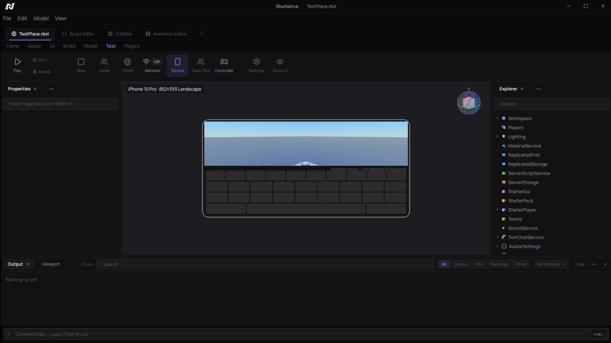

# Device Simulator: the open items

Labels: **Verified** (read from a primary source or measured here),
**Reported** (second-hand), **Unknown** (not found, or untested).
The Device Simulator itself (catalog, Edit letterbox, Play sizing, Sober
input modes) is in `crates/rbx_studio/src/device_sim.rs`,
`shell/device_sim.rs` and `workspace_view/device.rs`. This note covers what
was left open. Each item below has a verdict and the reasons for it.

Studio's own semantics come from creator-docs `studio/device-simulator.md`,
`studio/testing-modes.md` and the `StudioDeviceSimulatorService`, `Camera`
and `UserInputService` class pages (**Verified**, via `gh api`). Sober's come
from vinegarhq.org's Configuration, Tips and Tricks and FAQ pages
(**Verified**).

## 1. Live test of the Play half — built: the client reports itself

**Verdict:** this needs a person to press Play. Each Play now leaves a record
in Output, so the result of a live test can be read back afterwards.

`probe/client.luau` sends `{type = "device", ...}` (`Uplink::Device`) once at
start and again whenever a value changes. It checks every 0.25 s, and also
reacts at once when a TextBox gains or loses focus. The report carries:

- `Camera.ViewportSize`;
- `TouchEnabled`, `KeyboardEnabled` and `GamepadEnabled`;
- `GuiService:IsTenFootInterface()`;
- `PreferredInput`, read with a `pcall` because older clients lack it;
- `OnScreenKeyboardVisible`;
- whether a TextBox has focus.

While a device is simulated, the badge appends what the client reports, for
example `client 852×393 · touch · ten-foot off`. If the reported
`ViewportSize` is not the device's screen, the badge turns the warning colour
and names the expected size. The first report of each Play also goes to
Output as an Info line, for example
`Device check: ViewportSize 852×393, TouchEnabled true, …; simulated screen 852×393 (matches).`

Steps for a live test (Linux, Sober, X11):

1. Pick **Test → Device → iPhone 15 Pro**, landscape. Make the 3D view
   larger than 852×393 physical pixels.
2. Press **Play**. Wait for the client to appear inside the device bezel.
3. Read the Output line. Expected: `ViewportSize 852×393`, `TouchEnabled
   true` (Sober `touch_mode: "on"`) and `IsTenFootInterface false`.
   `ViewportSize` should equal the client window. Sober reports no safe-area
   insets, so the whole window is the viewport. **Unknown** until this run.
4. **Rotate to Portrait**. The client window resizes live. The badge should
   read `client 393×852` with no warning.
5. Stop. Pick **Xbox Series X**. Play again; Sober reads its input mode at
   launch only. Expected: `IsTenFootInterface true`
   (`use_console_experience`). **Unknown**: the Sober docs say only that
   "games may register you as a console user".
6. Focus a TextBox in the game. The badge's report flips `text_focus`, and
   the keyboard cover appears (item 5). `OnScreenKeyboardVisible` is
   expected to stay `false`, because Sober has no Android IME (**Unknown**).

## 2. Input modes on Windows — not possible from outside the client

**Verdict:** there is no switch. Nothing was built.

- `RobloxPlayerBeta` has no launch argument, setting or URI parameter that
  selects the touch or console UI (**Unknown**: none found). The
  `roblox-player:` parameters seen in the wild are launch plumbing only
  (**Reported**).
- Since 2025-09-29 the client honours only FFlags on Roblox's allowlist
  (**Verified**: devforum "Allowlist for local client configuration via
  Fast Flags"). The list holds geometry, rendering and one reduced-motion
  flag. None of them concerns touch, console or platform.
- `IsTenFootInterface` is "hardcoded to return true whenever the client runs
  on a console" (**Verified**: `GuiService.yaml`).
- Touch: since 2025-10-14, a device with a real touch surface reports
  `TouchEnabled = true` (**Verified**: devforum "Introducing PreferredInput
  and improved touch capabilities").
  - Windows can inject synthetic touch from a desktop app, with no admin
    rights stated: `CreateSyntheticPointerDevice` /
    `InjectSyntheticPointerInput` on Windows 10 1809+, and
    `InjectTouchInput` on Windows 8+ (**Verified**: Microsoft Learn).
  - Whether Roblox treats an injected pointer device as a touchscreen is
    **Unknown**. If the client decides from hardware enumeration, a
    synthetic device probably does not count.
  - Testing it would take a Windows machine. The test: inject a touch, then
    read `TouchEnabled` in the device report above.
- So on Windows, Play runs in the machine's own input mode. The Edit preview
  is unaffected.

## 3. Pixel density — built as display scaling in Edit

**Verdict:** density reaches no script. Roblox exposes no DPI member: the
`GuiService`, `UserInputService` and `GuiBase2d` pages have none
(**Verified**). Sober's `enable_hidpi` only "scales the game window to your
screen's pixel density" and reports nothing (**Verified**: Configuration
page). In Studio too, pixel density "drives physical-size scaling" and
nothing else (**Verified**). Its only observable effect is how big the
screen looks, so that is what was built.

- The catalog has each phone's and tablet's PPI and its pixels per point
  (or per dp) from the spec sheets. Monitors, TVs and the headset have none.
- **Device → Display scaling** offers three modes, persisted as
  `device_scaling`:
  - **Fit to window**, the default.
  - **Actual resolution**: one device point to one editor logical pixel,
    which is the size Play shows the client at.
  - **Physical size**: the device's inches on the monitor. The monitor is
    assumed to be 96 dpi × the window's scale factor, which is what Studio's
    auto-detect reads from the OS. There is no calibration slider. A screen
    with no density falls back to Fit.
- All three cap the Edit letterbox (`frame::Viewport::letterboxed`'s
  `max_scale`). A screen that does not fit still shrinks.
- Play stays 1:1, because a foreign window can be sized but not scaled
  (item 6).

## 4. A headset in Play — not possible on Linux; Windows untested

**Verdict:** Edit preview only, as before.

- Sober: "For VR, the Quest build does not ship with x86 code … We have no
  intention of changing this." (**Verified**: Sober FAQ.)
- Windows: Roblox's PC VR runs on OpenXR (**Reported**: Roblox VR
  guidelines). Studio supports "all VR headsets compatible with OpenXR"
  (**Verified**: `testing-modes.md`).
  - Meta's XR Simulator is "a lightweight OpenXR runtime that runs on your
    computer", with Quest profiles and keyboard, mouse or pad input
    (**Verified**: Meta developer docs). That makes it a plausible
    no-hardware runtime.
  - No one has reported running the Roblox client against it, so this is
    **Unknown**. Its licence terms and account needs are also **Unknown**.

## 5. On-screen keyboard and Android back button — built, with limits

### Keyboard cover

- Studio has a per-orientation keyboard height for each device. Its default
  is 0, meaning no cover (**Verified**). The docs do not say how Studio
  draws the keyboard.
- The catalog gives each phone and tablet an **approximate** system-keyboard
  height in points or dp. Neither Apple nor Google publishes one, and it
  varies with the keyboard app and its suggestion strip. Custom is 0.
- **Device → On-screen keyboard** draws a key grid of our own over the
  bottom of the screen.
  - In Edit it shows while the toggle is on.
  - In Play it shows while the toggle is on, and also whenever the client
    reports that a TextBox has focus. There it is cut out of the client
    window (`gpui_base::occlusion::probe`), so it sits above the game.
- **Limit:** the game is never told. `OnScreenKeyboardSize` stays (0, 0) and
  `OnScreenKeyboardVisible` stays false, because both are read-only and no
  API sets them. The cover shows what a keyboard would hide. It does not
  move the game's own UI the way a real keyboard can.

Edit mode, `RBX_STUDIO_DEVICE='iPhone 15 Pro,keyboard,physical'`, captured on
Xephyr at scale 1. The 852-point screen is drawn 533 px wide
(852 × 96 × 3 / 460).

### Android back button

- The catalog marks each device iOS, Android or other. Custom phones and
  tablets count as Android, because Sober runs the Android client.
- **Device → Android back button** is enabled while an Android device's
  client is embedded and shown, which is Studio's rule ("Enabled while the
  client view is active").
- When pressed, it focuses the embedded client and types Escape with XTest
  (`rbx_play::embed::x11`, `Embedded::press_escape`). XTest is used because
  clients drop `SendEvent` keys.
- Back in a running Android game opens Roblox's menu, and so does Escape.
  Which key Sober maps to Android's `KEYCODE_BACK` is not documented
  (**Unknown**: test live).
- Linux only. The item is disabled with a hint elsewhere.

## 6. A Play client larger than the 3D view — measured: not viable for Play

The client is a foreign window. Embedding reparents it at 1:1, so a device
that does not fit is refused ("Doesn't fit — enlarge the 3D view"). The
alternative is to let the client render at full size off-screen, capture it
with XComposite and draw it scaled in our view. A throwaway prototype was
run on the real desktop (GNOME/Mutter, X11, RTX 4070, python-xlib, plain
`XGetImage`; `XShmGetImage` was not tried), with `vkcube` reparented into a
640×360 toplevel:

- **Redirection:** `XCompositeRedirectWindow`, Manual and Automatic, both
  succeeded on the reparented child under Mutter with no `BadAccess`.
  `NameWindowPixmap` worked too. The pixmap held real pixels, including
  the part clipped by the 640×360 parent (99.9% non-zero bytes).
- **1280×720 (3.7 MB/frame):** capture median 3.2 ms, p95 5.4 ms. 60 fps
  would need 221 MB/s.
- **2532×1170:** Mutter clamped the top-level to the screen (1920×1044) before
  the reparent. At 1920×1044 (8.0 MB/frame): median 7.3 ms, p95 13.3 ms,
  481 MB/s at 60 fps. A true 2532×1170 frame is 11.9 MB, about 11 ms by
  extrapolation (not measured), and 711 MB/s.
- **Input:** a synthetic `XSendEvent` Escape was ignored by vkcube. Clients
  drop `send_event` input. A clipped child gets no pointer events in its
  clipped part. XTest moves the user's global pointer. So scaled input would
  need its own coordinate mapping and a real input path into a window that
  is partly off-screen. Nothing here provides that.
- **Zero copy:** Sober presents through DRI3/Present. Avoiding the readback
  would need a DRI3 pixmap imported into GPUI's renderer, which GPUI does
  not expose.

**Verdict:** capture-and-scale works for a low-rate preview. It is not
viable for a playable client:

- A readback costs most of a frame at phone sizes, before the upload to the
  GPU.
- Input cannot be forwarded cleanly.

The refusal stays. The workaround remains enlarging the 3D view, or
undocking it to its own window.
