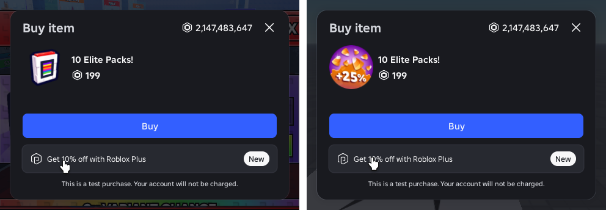
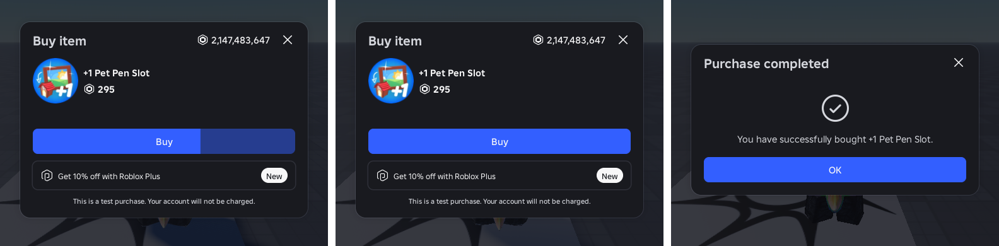
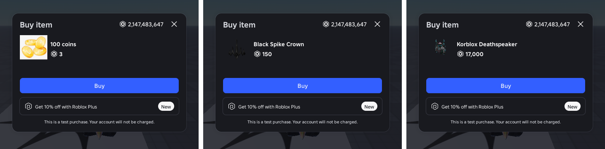
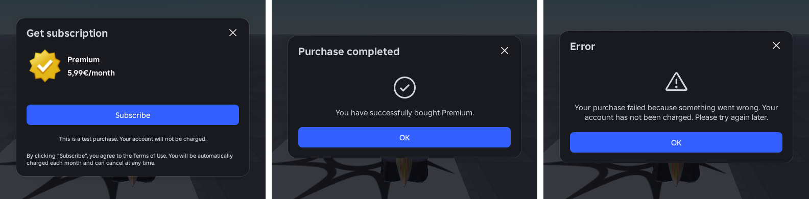

# Test purchases in the sandbox

The sandbox is a real published place. Real `MarketplaceService` prompts there
would charge real Robux, so Play swaps in a stand-in: `rbx_play::market`
rewrites the lookups, `probe/market.luau` is the proxy and server flow, and
`probe/market_ui.luau` is the dialog. This note records where each number in
the dialog comes from, so it can be re-checked when Roblox changes its prompt.

## Why a rewrite and not a patch
- `MarketplaceService` is an Instance (userdata). Luau cannot replace its
  methods, and `RunService.IsStudio = …` is not assignable either. The
  roadmap's first design (patch `IsStudio`, make games call a
  `MonetizationManager`) needed game changes. Rewriting
  `<expr>:GetService("MarketplaceService")` at publish time needs none.
- The wrap is inserted in place without new lines, so error lines and
  breakpoints (`instrument.rs`) still match the editor.
- Not caught: a service name built at runtime, and `game.MarketplaceService`
  indexing. Both are rare in games.

## Sources
- **Roblox's Foundation design system** ships as Lua source with Studio:
  `ExtraContent/LuaPackages/Packages/_Index/Foundation/Foundation/`.
  - `Components/Dialog/Dialog.lua` defines the motion. Opening slides from
    `Size_800` = 32 px below with `Ease.StandardOut` = cubic-bezier(0.2, 0, 0, 1)
    over `Time_300`. `GroupTransparency` is offset / 32. Closing uses
    `StandardIn` = (0.8, 0, 0.4, 1) over `Time_200`. The backdrop fades
    linearly over `Time_100`. The token values are in
    `RbxDesignFoundations-…-5.0.0/…/Default/Dark.lua`.
  - In `Components/Button/Button.lua`, `inputDelay` draws a `UIGradient` wipe
    (transparency 0 behind the progress, `DISABLED_TRANSPARENCY` = 0.5 after
    it). It eases with Otter's `Quad`, which is `t²`.
  - `Generated/StyleRules/…` holds the tag values: `radius-large` = 16,
    `stroke-default` = #D0D9FB at 0.88, `stroke-thick` = 1.5, the paddings and
    gaps, and the typography (`text-heading-small` is Bold 25 with LineHeight
    0.96, `text-body-small` is Regular 15 with LineHeight 1.2 and padding 1).
- **The purchase prompt app itself** is compiled into Studio and was not
  read. Its live instances were dumped instead from the Studio command bar
  during Play (`CoreGui.FoundationOverlay`, read with `Instance:GetStyled`).
  The dumps gave the dialog tree, every text style and colour, the hover
  colours (close #292A32, Buy #4069FF, Roblox Plus banner #D0D9FB at 0.92),
  the shadow sprite, and the "Purchase completed" view.
- **Live flags**
  (`clientsettingscdn.roblox.com/v2/settings/application/PCDesktopClient`)
  include `FFlagEnableDelayedInputForUnifiedPurchaseModalInExperience=True`
  and `FIntAXBuyDelayMilliseconds=650`. So the Buy delay is 0.65 s, not the
  1.5–2 s it can look like.
- **The reference screenshot** (a newer prompt than the Studio build on
  hand) fixed the header: a 456-wide dialog, Bold 25 #D5D7DD title, Medium 18
  balance, and a 40 × 40 close button with an 8 px radius. It also fixed the
  "New" pill (Medium 15, #202227 on #F7F7F8) and the backdrop. Its brightest
  backdrop pixel, (71, 71, 74), is white under #0A0A0E at 0.25 transparency:
  Foundation's `Scrim` token.

## Catalog items, bundles, subscriptions, errors
Studio's own prompt was dumped the same way for each of these.
- `PromptPurchase` (a catalog item) and `PromptBundlePurchase` open the same
  "Buy item" view as passes and products. A bundle's icon is its outfit
  (`Items` entry of `Type = "UserOutfit"`, thumbnail type `Outfit`). Bundle
  info has no `PriceInRobux`, only `UserBasePriceInRobux`.
- `PromptSubscriptionPurchase` opens "Get subscription". The price line is
  `DisplayPrice .. DisplaySubscriptionPeriod` (local currency, no Robux
  icon), the button says "Subscribe", and there is no Roblox Plus banner.
  Below the test disclaimer sits a Terms line (Medium 13, left aligned). The
  same "Purchase completed" view follows. `GetSubscriptionProductInfoAsync`
  only works on the client, so the server learns the name from the dialog.
  Real subscription ids for testing came from DevForum posts.
- An id with nothing behind it gets Roblox's "Error" view
  (`triangle-exclamation`, "Your purchase failed because something went
  wrong. Your account has not been charged. Please try again later.", OK).
- The 2026 API added `BindReceiptHandler` (filtered handlers, then
  catch-all handlers, then `ProcessReceipt`, each with its own decision
  enum) and `…Async` ownership calls. The stand-in covers both.
- Not covered: `Players.UserSubscriptionStatusChanged` is an engine event
  a script cannot fire. Bulk purchases and Roblox Plus/Premium prompts
  still go to the real prompts.

## Screenshots
All taken in real Studio from `examples/market_place.rs --demo`.

Reference (left) and ours (right), same item:

The Buy delay wipe, the idle dialog, then "Purchase completed":

A developer product, a catalog item and a bundle:

A subscription, its completed view, and the Error view:

## Verified
- The dialog was rendered in Studio from the module and compared with the
  reference. Every text and icon box lands on the same pixels. No interior
  pixel differs by more than 8 levels, outside the item image (a different
  item), the mouse cursor and the translucent corners.
- The open motion was sampled frame by frame in our dialog and in Roblox's
  own. The two agree to within 0.013 `GroupTransparency` at every sample.
- `examples/market_place.rs --demo` was opened in Studio (game-script
  identity, the real rewrite and inject). It walks a pass prompted from
  the server, then a product, a catalog item, a bundle, a subscription and
  an invalid id from the client. Each bought kind then reads as owned. The
  product reached the filtered `BindReceiptHandler` with a `DEV-` receipt.
  Every `…PurchaseFinished` signal fired with `true`, and with `false` for
  the invalid id. The BuilderIcons font and Foundation's shadow sprite load from
  `rbxasset://LuaPackages/…` in a game script.
- Not yet run in a published sandbox through Sober. The flow uses only
  APIs that behave the same there.
